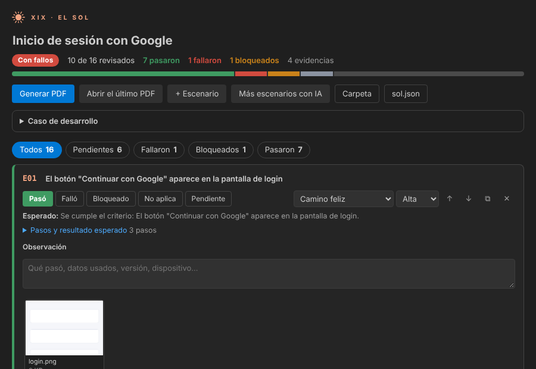

<p align="center"></p>

# XIX · El Sol

Extensión para **VS Code** y **Kiro**: le pasas un caso de desarrollo (historia de usuario, criterios de aceptación o descripción del cambio) y arma la lista de **escenarios de prueba**. Cada escenario tiene su **estado** (pasó, falló, bloqueado, no aplica, pendiente), una **observación** y sus **evidencias** (capturas, logs, videos). Al final genera un **informe en PDF**.

El Sol deja todo a la luz: lo que se probó, cómo salió y con qué evidencia.

<p align="center"></p>

## Qué hace

- **Escenarios con Gemini** (gratis con límite diario): camino feliz, validaciones, casos borde, errores, permisos, interfaz y regresión, con pasos y resultado esperado. Sin clave, sin internet o si Gemini no responde, usa una **plantilla por reglas** que saca los criterios del caso y agrega escenarios según el tema (formularios, inicio de sesión, red, listas, archivos, Android, pagos).
- **Más escenarios**: pide a Gemini otros que todavía no estén, con una indicación opcional («accesibilidad», «sin conexión»…).
- **Checklist**: botones de estado con atajos de una tecla fuera de los campos de texto (P pasó, F falló, B bloqueado, N no aplica, 0 pendiente), filtros y barra de avance. Todo se puede editar: título, tipo, prioridad, precondiciones, pasos y resultado esperado.
- **Evidencias por escenario**: botón **Adjuntar…**, **pegar una captura con Ctrl+V** (va al escenario donde estás) o arrastrar archivos (mantén **Shift** al soltar, así VS Code no abre el archivo).
- **Pruebas end-to-end**: graba, genera con Gemini o vincula pruebas de Playwright (web) y Maestro (Android); al ejecutarlas se marcan los estados y se adjuntan las capturas.
- **Informe PDF**: portada con el veredicto (Aprobado, Con fallos, Incompleto), barra de resultados, repositorio, rama, commit y responsable; el caso; una tabla resumen; y el detalle de cada escenario con sus **capturas dentro de la página**. Los demás archivos (logs, videos, .txt) van **adjuntos dentro del PDF**.

Mira un informe de ejemplo: [docs/ejemplo-informe.pdf](docs/ejemplo-informe.pdf).

## Instalar (Windows)

1. Doble clic en **`Instalar.bat`**. Instala `dist/el-sol-0.3.3.vsix` en VS Code y en Kiro (los que encuentre).
2. Clave de Gemini: si ya la guardaste para **La Justicia**, El Sol usa la misma. Si no, el instalador la pide (opcional). También se cambia luego con **El Sol: Configurar clave de Gemini**.

A mano: Extensiones → `···` → **Instalar desde VSIX…** → `dist/el-sol-0.3.3.vsix`.

No necesita Node.js ni instalar paquetes: la extensión corre con el motor del propio editor y trae su generador de PDF.

## Uso

1. Abre la carpeta de tu proyecto.
2. **Ctrl+Alt+Shift+T** (o `Ctrl+Shift+P` → **El Sol: Nuevo plan de pruebas**). Si tienes texto seleccionado en el editor, el caso viene relleno; también está **Crear plan de pruebas con la selección** en el menú del clic derecho.
3. Escribe el título, pega el caso y pulsa **Generar escenarios con Gemini** (o **Usar la plantilla**).
4. Revisa y ajusta los escenarios. Prueba cada uno: marca el estado, escribe la observación y adjunta la evidencia.
5. **Generar PDF**. Se abre en tu lector de PDF y queda en la carpeta del plan.

Para retomar un plan: **El Sol: Abrir plan de pruebas**, o clic derecho en `sol.json` → **Abrir plan de pruebas**.

## Pruebas end-to-end (web y Android)

Cada escenario puede tener su **prueba automática**. Al ejecutarla, El Sol marca el estado (pasó o falló), escribe la observación con el error y adjunta las capturas; si falla, también el video y el trace. Todo eso entra al PDF.

**Preparar el plan** (una vez, en el bloque «Pruebas automáticas» del panel):

- **URL** de la app web y, para Android, el **appId** (por ejemplo `com.miempresa.app`).
- **Instalar Playwright**: abre una terminal y corre `npm i -D @playwright/test` y `npx playwright install chromium` en tu proyecto.
- **Android** usa [Maestro](https://docs.maestro.dev) (elegido sobre Appium: flujos en YAML, sin servidor ni drivers). Para instalarlo: botón **Instalar Maestro** del panel, o doble clic en **`Instalar-Maestro.bat`**. Usa el Java de Android Studio, deja Maestro en `%LOCALAPPDATA%\maestro` y lo agrega al PATH (sin administrador). Con el emulador o el celular conectado por `adb`.
- **Más de un celular conectado** (por ejemplo, uno que da internet por USB): pon el número de serie del que se prueba en el ajuste `elsol.dispositivoAndroid` (lo ves con `adb devices`); si no, Maestro preguntaría cuál usar.

**Automatizar un escenario** (botones en cada escenario):

| Botón | Qué hace |
|---|---|
| **Grabar web** | Abre el navegador con `playwright codegen`; lo que hagas queda en `e2e/E03.spec.ts`. |
| **Generar web con IA** | Gemini escribe la prueba a partir de los pasos y del árbol de accesibilidad real de la página. |
| **Grabar Android** | Abre `maestro studio` para armar el flujo `e2e/E03.yaml`. |
| **Generar Android con IA** | Gemini escribe el flujo de Maestro con la pantalla actual del dispositivo. |
| **Vincular…** | Usa una prueba que ya tienes (`.spec.ts`, `.test.js`, `.yaml`). |

Luego **▶ Ejecutar** en el escenario, o **▶ Ejecutar automatizadas** en la cabecera para correrlas todas. La salida aparece en el canal «El Sol · pruebas end-to-end».

Usuarios y contraseñas de prueba van en `e2e/.env` (`E2E_USUARIO=…`), que queda en `.gitignore`. En las pruebas se leen con `process.env.E2E_USUARIO` (web) o `${E2E_USUARIO}` (Maestro). Gemini nunca recibe esos valores.

Desde la terminal:

```powershell
node C:\Git\el-sol\vscode\nucleo\cli.js e2e pruebas\2026-11-06-inicio-de-sesion E01 E03
node C:\Git\el-sol\vscode\nucleo\cli.js junit pruebas\2026-11-06-inicio-de-sesion reporte.xml "npx cypress run --reporter junit"
```

`junit` sirve para Cypress, Selenium, Espresso o cualquier herramienta que deje un reporte JUnit XML: los casos cuyo nombre incluye `E03` actualizan ese escenario.

## Dónde se guarda

Dentro del proyecto, para que viaje con git:

```
pruebas/
  2026-11-06-inicio-de-sesion-con-google/
    sol.json                                   ← caso, escenarios, estados y observaciones
    adjuntos/
      E01-01-login.png
      E04-01-error.png
      E04-02-logcat.txt
    2026-11-06-inicio-de-sesion-con-google.pdf ← el informe (se regenera cuando quieras)
```

- `sol.json` es JSON legible: se puede revisar en un pull request o editar a mano. Si cambia por fuera (por ejemplo, con `git pull`), el panel se actualiza solo.
- Cada adjunto puede pesar hasta 25 MB. Si no quieres subir los PDF o los videos a GitHub, agrégalos a `.gitignore` (`pruebas/**/*.pdf`, `pruebas/**/*.mp4`).

## Ajustes

| Ajuste | Por defecto | Para qué |
|---|---|---|
| `elsol.carpeta` | `pruebas` | Carpeta del proyecto donde se guardan los planes. |
| `elsol.modelo` | `gemini-3.5-flash-lite` | Modelo de Gemini. `gemini-3.8-flash` escribe mejor pero tiene menos cupo gratis. |
| `elsol.cantidad` | `entre 8 y 15 escenarios` | Cuántos escenarios pedir en un plan nuevo. |
| `elsol.abrirPdfAlTerminar` | `true` | Abrir el PDF al generarlo. |
| `elsol.dispositivoAndroid` | (vacío) | Número de serie del celular para Maestro. Vacío = `ANDROID_SERIAL` o el único conectado. |

## Privacidad

Con Gemini, **el texto del caso se envía a Google** (API de Gemini, con tu clave). No pegues contraseñas, datos de clientes ni información confidencial en el caso. Las evidencias **nunca** se envían: se quedan en tu carpeta y en el PDF.

## Desde la terminal (Visual Studio, Android Studio…)

El núcleo también funciona solo con Node.js 18+:

```powershell
node C:\Git\el-sol\vscode\nucleo\cli.js nuevo "Búsqueda de productos" caso.txt
node C:\Git\el-sol\vscode\nucleo\cli.js lista
node C:\Git\el-sol\vscode\nucleo\cli.js pdf pruebas\2026-11-06-busqueda-de-productos
```

Los estados y las evidencias se marcan en VS Code o Kiro (o editando `sol.json`).

## Para desarrollar

- `vscode/extension.js`: comandos y panel (webview). `vscode/media/`: interfaz del panel.
- `vscode/nucleo/sol.js`: formato del plan, Gemini, plantilla y adjuntos (sin VS Code, sin dependencias).
- `vscode/nucleo/e2e.js`: pruebas automáticas (Playwright, Maestro, JUnit) y lectura de sus reportes. `capturar-pagina.js`: árbol de accesibilidad para Gemini.
- `vscode/nucleo/informe.js`: el PDF, con [pdf-lib](https://github.com/Hopding/pdf-lib) 1.17.1 (MIT) incluido en `vscode/vendor/`.
- Pruebas: `node tests/correr.js` (núcleo, PDF, extensión con un VS Code simulado y, si está Playwright, el panel en Chromium).
- Empaquetar: `cd vscode` y `npx @vscode/vsce package -o ../dist/`.

Parte del mazo de [davidsant7e](https://github.com/davidsant7e). Licencia MIT.
